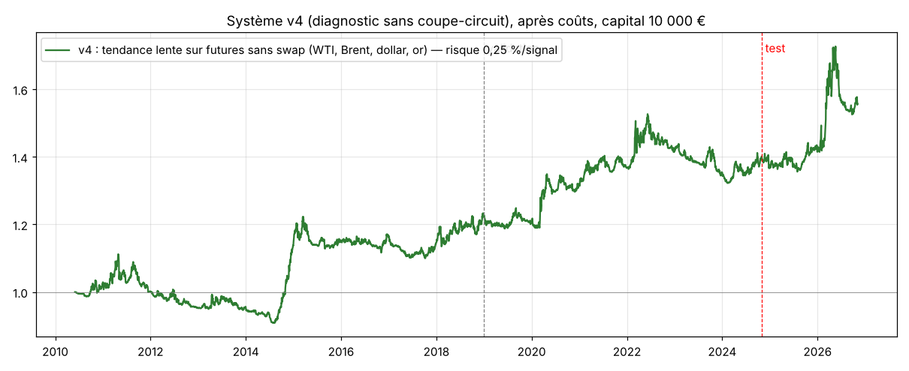
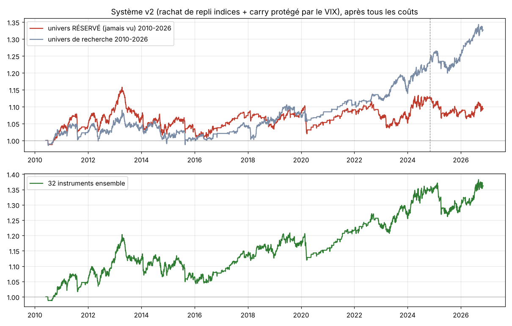
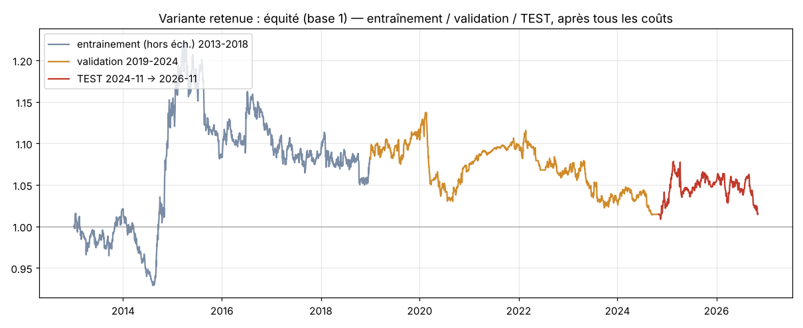

# Swingbot : rapport final (nuit du 4 au 5 novembre 2026)

## 🆕🆕 Vagues 4 et 5 : le système v4 (tendance lente sur futures sans swap, MT5)

### Verdict en une phrase
**Le meilleur candidat de la nuit est la v4 : une tendance lente sur les futures CFD sans swap d'IC Markets (pétrole WTI et Brent, dollar, or), disponibles uniquement sur MT5.** Sur 2010-2026, elle fait un profit factor de 1,64, un Sharpe de 0,42 et +2,7 %/an à 0,25 % de risque par signal, avec une pire baisse de -18 %. Elle reste positive sur l'or, jamais testé avec cette idée (PF 2,4), et sur la période neuve 2024-2026 (PF 1,16 pour pétrole + dollar). Elle **n'atteint toujours pas un Sharpe de 0,8**. **Démo MT5 recommandée, pas d'argent réel.**



### ⚠️ Mauvaise nouvelle d'abord : la v2 ne tient pas
Testée sur un **2e univers réservé** de 14 instruments jamais vus (7 croisées FX ; indices HK50, ES35, NETH25, SWI20, CA60, US2000, IT40), la v2 fait **PF 0,84, Sharpe -0,26**, et le coupe-circuit se déclenche à -21 %. Sur les 46 instruments réunis, le PF tombe à 1,03, autrement dit rien. Le petit avantage vu en vague 2 était **très probablement de la chance**. La v3 (v2 + vote de replis) échoue de la même façon.

### Vague 4 (recherche sur 32 instruments)
| Idée | Résultat |
|---|---|
| IBS sur indices (Pagonidis 2013) | ✘ disparaît après coûts, une fois l'entrée faite à l'ouverture suivante |
| Série de N baisses sur indices | ✘ 2 réglages sur 4 |
| dip_vote : plusieurs signaux de repli d'accord (maison) | ✅ 3/4 en recherche → **✘ sur l'univers réservé n°2** |
| **IA directe** : un LightGBM commun à tous les instruments prédit le mouvement à 5 jours, réentraîné chaque année | ✘ positif avant frais en validation, négatif en 2010-2018 |

### Vague 5 : les futures CFD **sans swap** (MT4/MT5 uniquement chez IC Markets)
IC Markets EU propose des futures CFD sur le **VIX, le WTI, le Brent et le dollar (DXY)**, plus l'or (GC), **sans swap** : le coût de portage est intégré au prix. C'est exactement ce qui tuait le suivi de tendance en vague 1.
- **Données** : des ETF qui détiennent ces futures servent de substituts (VIXY, USO, BNO, UUP, GLD). Ils sont **corrigés** : le taux d'intérêt USD est retiré aux acheteurs, parce que les ETF touchent des intérêts sur leur trésorerie, contrairement à un CFD. Les frais de gestion sont rendus. Spreads IC : VIX 0,07, WTI 0,04, Brent 0,03, DXY 0,03, GC 0,23.
- **Prime de volatilité** (vendre le VIX futur quand la courbe est en contango) : ✘ 1 réglage sur 4, avec des pertes de -2,5 R d'un coup lors des krachs. C'est le piège « gros taux de réussite, pertes rares énormes » : je l'élimine.
- **Tendance (canal de Donchian) sur WTI, Brent et DXY** :
  - 20 jours : nul (bruit) ;
  - **55, 100 et 150 jours : tous positifs** sur l'entraînement et la validation, et sur les 3 instruments, de +0,14 à +1,6 R par trade.

### Le verdict v4 (figé et commité avant exécution : `scripts/futures_verdict.py`)
Système : ensemble des 3 durées 55, 100 et 150 jours, stop à 3 ATR, 0,4 % de risque par signal.
| Bloc jamais vu | Trades | PF | Sharpe | R moyen |
|---|---|---|---|---|
| (A) WTI, Brent et dollar, 2024-11 → 2026-11 | 47 | 1,16 | 0,15 | +0,16 (WTI +0,41, Brent +0,44, **DXY -0,61**) |
| (B) **Or en futures, 2010-2026** (instrument jamais testé) | 119 | **2,40** | 0,43 | **+0,82** |

- **Le portefeuille complet, tel que figé, s'est arrêté en août 2012** : il a gagné +18 % jusqu'en avril 2011, puis rendu -20 %, et le coupe-circuit a coupé pour de bon. Ce n'est pas un bug, c'est la nature du suivi de tendance : de longues rechutes.
- **Diagnostic sans coupe-circuit** (pas un verdict, je le signale) :

| Risque/signal | Rendement/an | Sharpe | PF | Pire baisse | Années + |
|---|---|---|---|---|---|
| 0,40 % | +4,2 % | 0,43 | 1,63 | -28 % | 11/16 |
| **0,25 %** | **+2,7 %** | 0,42 | 1,64 | **-18 %** | 11/16 |
| 0,15 % | +1,7 % | 0,41 | 1,66 | -12 % | 11/16 |

  À 0,25 %, sur 2024-2026 : +5,9 %/an, PF 2,1. **C'est ce réglage (0,25 %) que le bot utilise.**
- **Limites** : 4 instruments seulement, des données de substitution, un Sharpe d'environ 0,4, et le dollar qui perd sur la période neuve. **124 essais** au total depuis le début de la nuit.

### Le bot MT5 fait tourner la v4 par défaut
- `SWINGBOT_SYSTEM=v4`. Les signaux sont calculés sur les séries continues ; l'ordre part sur le future du broker, avec un stop en **% du prix**.
- Le **volume est recalculé par MT5 à partir de la valeur du tick**, donc le risque en euros est exact, quelle que soit la taille du contrat.
- **Expiration des futures** : le broker clôture au règlement. Le bot détecte la raison de la clôture dans l'historique MT5 (stop, manuel ou autre), puis **rouvre la position sur le contrat suivant** si la tendance tient toujours.
- Les noms des symboles sont réglables (`SWINGBOT_MT5_MAP`), voir `mt5/LISEZMOI_MT5.md`.
- 15 tests passent, dont le volume à partir de la valeur du tick et la détection expiration ou stop. Rejouer août-octobre 2026 en mode papier donne 13 entrées, sans erreur.

---

## 🆕 Vague 2 : système v2 et bot de démo

### Verdict en une phrase
**Le système v2 a un avantage réel mais mince.** Il reste positif sur 16 instruments jamais vus (profit factor 1,07) et sur une période jamais vue (profit factor 1,59, Sharpe 0,79), mais il **n'atteint pas les critères** (PF > 1,3 et Sharpe > 0,8) sur l'univers réservé. Le faire tourner **en démo pendant 2 à 3 mois** est raisonnable, sans risquer d'argent. Passer en argent réel, non, pas sur ces chiffres.



### Ce qui a changé de méthode
- La période test 2024-2026 était « grillée » par la vague 1. J'ai donc **mis de côté 16 instruments jamais regardés** : EURCHF, EURAUD, GBPCHF, CADJPY, NZDJPY, AUDNZD, EURCAD, GBPAUD, CHFJPY, AUDCAD, UK100, JP225, F40, STOXX50, US30 et AUS200, avec leurs frais officiels IC Markets. Les idées ont été choisies sur l'univers de recherche, puis jugées **une seule fois** sur ces instruments réservés.
- La règle de sélection a été figée avant le verdict (et commitée avant exécution) : une idée est gardée si au moins 3 réglages sur 4 sont positifs après coûts, à la fois en entraînement et en validation.

### Les 6 idées testées : des horizons courts, pour échapper au coût des swaps
| Idée | Inspiration | Entraînement → validation (R moyen net) | Retenue ? |
|---|---|---|---|
| **idx_dip** : acheter un indice après une forte baisse sur 2 jours (RSI(2) < 5), revendre au rebond | retour à la moyenne court terme des indices | +0,02 à +0,04 → +0,07 à +0,10 (4 réglages sur 4 positifs) | ✅ |
| **carry_safe** : encaisser le swap positif en forex **seulement** quand le VIX est bas et en baisse, sortir dès que la peur monte | idée maison (le carry rapporte peu à peu puis perd tout lors des paniques) | 3 réglages sur 4 positifs sur les deux blocs | ✅ |
| tom : tournant du mois sur indices | Ariel 1987, McConnell & Xu 2008 | mitigé | ✘ |
| pre_fomc : achat des indices avant la Fed | Lucca & Moench 2015 | 1 réglage sur 2 | ✘ |
| me_usd : flux de couverture de fin de mois sur le dollar | Melvin & Prins 2015 | **négatif** | ✘ |
| vix_crush : rachat après une panique du VIX | idée maison | mitigé | ✘ |

### Résultats du système v2 (idx_dip + carry_safe, risque 0,75 %/trade, frais réels IC Markets)
| Bloc | Sharpe | PF | Rendement/an | Pire baisse | Trades |
|---|---|---|---|---|---|
| Recherche, entraînement 2010-2018 | 0,19 | 1,12 | +0,7 % | -9 % | 280 |
| Recherche, validation 2019-2024 | 0,70 | 1,59 | +2,3 % | -5 % | 174 |
| **Instruments RÉSERVÉS 2010-2026 (jamais vus)** | **0,16** | **1,07** | **+0,5 %** | **-13 %** | 735 |
| **Période NEUVE 2024-11 → 2026-11** | **0,79** | **1,59** | **+3,3 %** | **-5 %** | 95 |
| Les 32 instruments ensemble 2010-2026 | 0,40 | 1,22 | +1,9 % | -13 % | 899 |

- **Robustesse**, sur l'univers de recherche 2010-2024 : avec des coûts ×1,5, Sharpe 0,29 et PF 1,22 ; avec des réglages à -20 %, PF 1,12 ; à +20 %, PF 1,16. Le système reste positif partout. C'est la grosse différence avec la vague 1.
- Sur les instruments réservés, chacune des deux idées reste positive : environ +0,02 R par trade. 9 instruments sur 16 et 9 années sur 17 sont gagnants. Les gros gains viennent de JP225, NZDJPY et CADJPY ; les pertes, d'AUS200 et GBPAUD.
- **Nombre total d'essais** depuis le début : **72**. Avec autant d'essais, un Sharpe de 0,4 sur 16 ans reste fragile. C'est pour ça que la démo est indispensable.
- **Monte Carlo** (32 instruments) : drawdown médian -9 %, -14 % dans 5 % des cas, -17 % dans 1 % des cas. 58 % des mois sont positifs. Rendement mensuel : -1,3 % (mauvais mois), +0,3 % (médian), +1,8 % (bon mois).

### En euros, pour les 32 instruments sur 2010-2026
| Capital | Rendement/an | Gain total en 16 ans | Pire baisse | Signaux refusés (lot minimum) |
|---|---|---|---|---|
| 200 € | +0,8 % | +28 € | -6 % | 1 083 |
| 500 € | +1,0 % | +86 € | -9 % | 781 |
| 1 000 € | +1,1 % | +189 € | -9 % | 658 |
| 3 000 € | +2,1 % | +1 215 € | -13 % | 51 |
| 10 000 € | +1,9 % | +3 617 € | -13 % | 0 |

➡️ Le bot ne devient « complet » qu'**à partir d'environ 3 000 €**. En dessous, le lot minimum de 0,01 l'oblige à refuser la majorité des signaux. Même à 10 000 €, ça fait environ **+190 €/an en moyenne**, pas un revenu.

### Le bot (démo uniquement)
- `swingbot/live.py` : à lancer une fois par jour après la clôture, vers 22h15 UTC. Il :
  - recharge les données ;
  - applique le coupe-circuit (-3 % sur la journée, -6 % sur la semaine, arrêt définitif à -20 %) ;
  - consulte le filtre news (défense uniquement) ;
  - décide des sorties (signal, durée maximale, choc de news), puis des entrées, avec les limites par devise, le risque total et l'arrondi au lot ;
  - **journalise chaque décision** dans `logs/live_decisions.jsonl` (idée, raison, taille, risque en €, refus et pourquoi).
- `swingbot/ctrader.py` : connecteur cTrader Open API.
  - **Mode papier par défaut.** Le mode `demo` **vérifie que le compte est bien un compte démo** avant tout ordre.
  - Le mode `live` est **refusé** sans `SWINGBOT_LIVE_CONFIRM=JE_COMPRENDS_LES_RISQUES`, et c'est testé automatiquement.
  - Les identifiants sont uniquement dans des variables d'environnement.
- `scripts/compare_live.py` : compare le journal de démo au backtest sur la même période (trades communs, manqués, écart de R moyen).
  - ⚠️ Effet de démarrage connu : au premier jour, le bot entre dans toutes les positions de carry déjà « actives ». Pour comparer, ignorez la première semaine.
- ⚠️ **Pas encore testé contre les serveurs cTrader** : il faut vos identifiants d'application. Le premier lancement en démo doit se faire avec vous derrière l'écran.
- Les stops sont gérés par le broker (stop envoyé avec l'ordre). En mode papier, les stops ne sont pas simulés : on clôture au cours de clôture.

---

## 🆕 Vague 3 et dimensionnement (nuit du 4 au 5 nov., suite)

### MetaTrader 5
Le bot tourne aussi sous **MT5** : `swingbot/mt5_broker.py`, `mt5/LISEZMOI_MT5.md`, `mt5/lancer_swingbot_mt5.bat`.
- Mêmes garde-fous qu'avec cTrader : démo vérifiée et réel verrouillé.
- Le bot ne gère que ses positions (numéro magique 20261105).
- L'historique peut être exporté depuis MT5 pour recaler le backtest sur les vraies bougies du broker.
- 4 tests utilisent un faux module MT5. ⚠️ Rien n'a été essayé avec un vrai terminal : le premier lancement doit se faire en démo, avec vous devant l'écran.

### Vague 3 : 5 nouvelles idées, **aucune ne passe le tamis**
Même règle : au moins 3 réglages sur 4 positifs en entraînement **et** en validation, sur l'univers de recherche.
| Idée | Réglages positifs sur les 2 blocs | Verdict |
|---|---|---|
| trend_carry : tendance FX seulement dans le sens du swap positif (idée maison) | 0/4, forte perte en entraînement | ✘ |
| fx_rev_xs : retournement hebdomadaire transversal du FX | 0/4, négatif en entraînement | ✘ |
| squeeze : contraction de volatilité, puis entrée dans le sens de la tendance | 1/4 | ✘ |
| idx_dip_vix : rachat de repli seulement quand le VIX est élevé | 2/4, le plus proche | ✘ |
| fx_dip_carry : rachat de repli FX dans le sens du swap (idée maison) | 1/4 | ✘ |

Aucune n'a donc été présentée à l'univers réservé. **Total : 92 réglages testés depuis le début.** Le système v2 reste le seul candidat.

### Combien risquer ? (système v2 inchangé, 32 instruments, 2010-2026, `results/v2_sizing.csv`)
| Capital | Risque/trade | Rendement/an | Pire baisse | Gain moyen/an |
|---|---|---|---|---|
| 200 € | 0,75 % | +0,8 % | -6 % | ≈ 2 € |
| 1 000 € | 0,75 % | +1,1 % | -9 % | ≈ 11 € |
| 1 000 € | 1 % | +1,7 % | -12 % | ≈ 17 € |
| 3 000 € | 0,75 % | +2,1 % | -13 % | ≈ 63 € |
| 10 000 € | 0,75 % | +1,9 % | -13 % | ≈ 190 € |
| 10 000 € | 1 % | +2,5 % | -18 % | ≈ 250 € |
| 10 000 € | 1,5 % | **+1,0 %** | -21 % | le coupe-circuit à -20 % arrête le bot |

- **Au-delà de 1 % de risque par trade, ça casse** : le drawdown touche -20 %, le coupe-circuit coupe tout, et le rendement s'effondre. **Gardez 0,75 %.**
- Sous 1 000 €, v2 = **idx_dip seul** dans les faits : le lot minimum de 0,01 en forex rend le carry impossible, alors que la granularité des indices le permet encore.
- Le Sharpe reste d'environ 0,4 quel que soit le réglage. Le dimensionnement ne crée pas d'avantage, il ne fait que le multiplier, lui et le risque.

### Ce que je n'ai pas pu faire, et qui pourrait changer la donne
1. **Le H1 sur 10 ans** (Dukascopy depuis votre PC). Avec 2 ans de H1 Yahoo, impossible de valider quoi que ce soit en intraday.
2. **Une exécution plus fine** : entrer sur `idx_dip` juste avant la clôture plutôt qu'à l'ouverture suivante. Il faut des données intraday pour le mesurer honnêtement.
3. **Les vraies bougies du broker** : `scripts/export_mt5_history.py`, puis relancer `scripts/ideas_final.py`.

---

# Vague 1 (archive)

## Verdict en une phrase

**Non : aucune configuration n'atteint les critères sur le bloc de test.** Le résultat est un Sharpe de 0,03 et un profit factor de 1,01 sur 2024-2026, après coûts. Ça ne vaut pas le coup de passer en démo **en espérant un revenu**. Une démo n'aurait d'intérêt que pour apprendre.

| Critère (bloc test 2024-11 → 2026-11, après tous les coûts) | Exigé | Obtenu | ✔/✘ |
|---|---|---|---|
| Profit factor | > 1,3 | 1,01 | ✘ |
| Sharpe annualisé | > 0,8 | 0,03 | ✘ |
| Drawdown max | < 20 % | 5,9 % | ✔ (mais il y a peu de trades) |
| Rentable la majorité des années et instruments | oui | non (7 instruments sur 16 gagnants, 5 années sur 14) | ✘ |
| Robustesse | oui | non (résultats instables selon les paramètres) | ✘ |
| Probabilité que le Sharpe soit réel (Deflated Sharpe, 52 essais) | élevée | **2,5 %** | ✘ |

Sur la même période, **conserver simplement** l'or (+43 %), le S&P 500 (+32 %) ou le DAX (+34 %) aurait fait bien mieux. Ces chiffres sont des variations de prix, sans frais. Attention, ce n'est pas comparable à un CFD, qui paie environ 10 % par an de financement sur les indices.



*Courbe d'équité de la variante retenue, après tous les coûts. Chaque bloc est hors échantillon : l'entraînement 2013-2018 est en walk-forward, la validation est en 2019-2024 et le test, figé, en 2024-2026. La courbe est plate : le seul gros gain vient de 2015 (USD/JPY), le reste fait du surplace.*

---

## Ce qui a été fait

### Étape 1 : les données
- ⚠️ **Dukascopy était bloqué** depuis le cloud (erreur HTTP 429). J'ai utilisé **Yahoo Finance** à la place : **D1 de 2010 à 2026** pour 16 instruments (7 majeures, EURJPY, GBPJPY, AUDJPY, EURGBP, or, argent, US500, NAS100, GER40), et seulement 2 ans de H1. L'étude est donc faite en **D1**. Les fichiers que vous avez déposés (`data_bars`, `data_daily`) sont eux aussi des données Yahoo, sur des périodes plus courtes. Dans `data_h1/_raw`, il n'y a que 21 mois de Dukascopy, sur l'or seulement.
- Taux directeurs des 8 devises (FRED/OCDE) pour le carry et les swaps. Calendrier FOMC officiel (133 décisions) et NFP (204 dates reconstruites). **Pas d'historique BCE, BoE, BoJ ni CPI** accessible.
- Contrôle qualité : pas de doublons, bougies du dimanche supprimées, mèches fantômes de Yahoo rabotées. **Les vrais krachs sont conservés** : une première version du filtre les effaçait par erreur, ce qui aurait rendu le backtest trop beau.

### Étape 2 : le moteur (`swingbot/backtest.py`, `swingbot/costs.py`)
- Signal à la clôture, exécution à l'ouverture suivante, stop en ATR. Gap au-delà du stop : exécution à l'ouverture. Stop et objectif touchés dans la même bougie : on suppose le stop d'abord.
- **Vrais frais IC Markets EU**, relevés le 4 nov. 2026 sur la page officielle *Spreads and Swaps* :
  - commission cTrader de 3 $ par 100 000 $ et par côté ;
  - spreads moyens Raw : EURUSD 0,06, GBPUSD 0,26, USDJPY 0,22, or 0,08 $, US500 0,36 pt, USTEC 1,57 pt, DE40 1,46 pt ;
  - marges de swap déduites des swaps publiés : **forex ≈ 1 %/an, or ≈ 0,75 %/an, indices ≈ 5,5 %/an**. Une position acheteuse sur US500 paie environ **10 % par an** de financement.
  - Prudence ajoutée : spread ×1,5, plus 0,5 spread de glissement à l'entrée et 1,5 spread sur les stops.
- Swaps débités chaque nuit, triplés le mercredi (forex et métaux) ou le vendredi (indices).
- **Tests automatiques** (`tests/test_engine.py`, 6 tests, tous verts) :
  - aucune fuite du futur (on modifie le futur et on vérifie que les signaux passés ne bougent pas) ;
  - exécution à l'ouverture suivante ;
  - gap au-delà du stop ;
  - stop d'une vente ;
  - triple swap.

### Étape 3 : les stratégies (`swingbot/strategies.py`)
9 familles, **49 configurations** au total. Les grilles sont volontairement petites.
- Donchian, croisement de moyennes, momentum série temporelle, et sa version lente sur 12 mois, rebalancée chaque mois.
- Retour à la moyenne (z-score en range), RSI(2) dans le sens de la tendance.
- Momentum transversal, carry FX avec filtre de tendance.
- « Tendance longue » : position acheteuse uniquement sur les indices et l'or, tant que le prix est au-dessus de sa moyenne à 100 ou 200 jours. Horizon de plusieurs mois.
- Ciblage de volatilité : chaque trade risque le même montant, grâce au stop en ATR et au risque fixe en %.

**Constat, avant tout filtre IA** (R moyen par trade, entraînement → validation) : le suivi de tendance est légèrement positif **avant frais** sur 2010-2018 (+0,05 à +0,35 R). **Après frais et swaps**, il devient négatif, puis franchement négatif sur 2019-2024. Ce qui marchait sur un bloc ne marche plus sur le suivant.

### Étape 4 : la couche IA (`swingbot/ai.py`, `swingbot/portfolio.py`, `swingbot/news.py`)
- **Régime de marché** : rang de volatilité, efficacité de la tendance, volatilité moyenne de l'univers. Ce sont des seuils simples, que le modèle utilise comme caractéristiques.
- **Méta-labellisation** : LightGBM (8 feuilles, fortement régularisé), réentraîné chaque année sur le passé seulement, avec purge des trades à cheval sur deux périodes.
  - Il prédit bien la **probabilité de gain** : 25 % de gagnants dans le décile bas, 56 % dans le décile haut.
  - Mais il ne prédit **pas l'espérance** : le décile haut fait tout juste 0 R. Il trie surtout « des petits gains fréquents » contre « des gros gains rares », sans trouver d'avantage.
- **Allocateur** : classement par espérance en R, au plus 8 positions, au plus 5 % de risque ouvert, **exposition nette au plus 2 trades par devise**, marge au plus 50 %.
- **Coupe-circuit** : -3 % sur une journée, -6 % sur une semaine, -20 % de drawdown (arrêt complet).
- **Filtre calendrier** (pas d'entrée la veille ou le jour d'un FOMC/NFP) : testé, il **n'améliore pas** le résultat, donc il n'est pas retenu.
- **Lecteur de news par IA**, uniquement en défense. Il lit le calendrier de la semaine (ForexFactory) et les flux RSS (Fed, BCE, FXStreet, Investing). Le LLM est interchangeable (Ollama en local ou API Anthropic). Le code **ignore toute action autre que** bloquer, réduire, resserrer ou couper, et chaque décision est journalisée. **Il ne peut pas être backtesté** : il ne sera jugé qu'en démo.

### Étape 5 : le risque
Risque par trade de 0,75 % (modulé entre 0,5 et 1 % par le score IA), plus les limites ci-dessus. Tout se règle dans `RiskConfig` (`swingbot/portfolio.py`).

---

## Méthodologie et honnêteté

- **Trois blocs chronologiques** : entraînement 2010-2018, validation 2019 → oct. 2024, **test nov. 2024 → nov. 2026**. Le test n'a été lu **qu'une seule fois**, par `scripts/final_test.py`, avec une règle de choix figée avant : le meilleur Sharpe en validation, donc la variante D (sélection walk-forward, score IA, pas de vente des indices).
- **Walk-forward** : chaque année, pour chaque famille, on reprend la meilleure configuration des 4 années précédentes, mais seulement si elle était positive.
- **Nombre d'essais** : 49 configurations, 6 variantes de portefeuille et 3 scénarios de coûts, soit **≈ 52 à 58 essais**. Avec autant d'essais, **le hasard seul peut produire un Sharpe d'environ 1,4**. C'est pour ça que le Deflated Sharpe ne vaut que 2,5 %.
- **Variantes de portefeuille en validation** (capital 10 000 €) : aucune ne dépasse un Sharpe de 0,06 (voir `results/research_variants.csv`).
- **Petite instabilité à signaler** : la même variante D donne un Sharpe de +0,06 en validation dans `run_research.py` et de -0,29 dans `final_test.py`. La seule différence est l'inclusion des trades de validation qui se terminent pendant le test. Qu'un détail pareil fasse basculer le résultat confirme qu'il n'y a **pas d'avantage réel**, juste du bruit.

### Tests de robustesse (variante D)
| Test | Validation : Sharpe / PF | Test : Sharpe / PF |
|---|---|---|
| Base | -0,29 / 0,86 | 0,03 / 1,01 |
| Coûts ×1,5 | 0,51 / 2,51 (seulement 23 trades : le filtre IA bloque presque tout) | 0,01 / 1,04 (3 trades) |
| Paramètres -20 % | 0,22 / 1,11 | 0,64 / 1,40 |
| Paramètres +20 % | -0,23 / 0,88 | 0,55 / 1,84 |

Les résultats partent dans tous les sens selon de petites variations. C'est la signature du **bruit**, pas d'une stratégie solide. Ne vous laissez pas tenter par la ligne « -20 % » : la choisir après coup, c'est exactement le surapprentissage qu'on veut éviter.

- **Monte Carlo** sur l'ordre des trades : drawdown médian -21 %, pire cas à 5 % de probabilité : -30 %, pire cas à 1 % : -33 %.
- **Par instrument** (2013-2026) : 7 instruments gagnants sur 16. USDJPY à lui seul fait +1 505 € sur 10 000 €, NZDUSD perd -820 €, l'argent -673 €.
- **Par année** : 5 années positives sur 14. 2015 fait l'essentiel du gain total.

### Ce que ça donnerait en euros (rendements mensuels hors échantillon)
| | Mauvais mois (10 %) | Mois médian | Bon mois (90 %) |
|---|---|---|---|
| Rendement mensuel | -1,9 % | +0,08 % | +1,5 % |
| Sur 1 000 € | -19 € | +0,8 € | +15 € |
| Sur 10 000 € | -190 € | +8 € | +150 € |

Pire drawdown probable (Monte Carlo à 95 %) : **-30 %, soit -300 € sur 1 000 € et -3 000 € sur 10 000 €**, pour un gain médian proche de zéro.

### Le problème des petits comptes (votre question des 200 € / 500 €)
En swing, le stop est large : souvent 1 à 3 % du prix. Or le **lot minimum de 0,01** représente déjà 10 à 50 € de risque sur un stop de ce genre. Avec 0,75 % de risque par trade :
| Capital | Signaux refusés faute de lot assez petit (test) | Trades pris | Gain sur le test |
|---|---|---|---|
| 200 € | 98 | 6 | -3,6 € |
| 500 € | 95 | 9 | -1,2 € |
| 1 000 € | 62 | 14 | +11 € |
| 10 000 € | 15 | 36 | +8 € |

En dessous de 2 000 à 3 000 €, **le bot ne peut tout simplement pas respecter sa propre gestion du risque**. Il faudrait risquer 3 à 10 % par trade, et là, c'est du casino.

---

## Limites et risques identifiés
1. Les données Yahoo ne valent pas Dukascopy : l'or et l'argent viennent de contrats à terme continus, les indices des cours au comptant. Mais en D1, l'effet est faible devant l'ampleur des frais.
2. Les marges de swap sont celles de **novembre 2026**, appliquées à tout l'historique.
3. Pas d'historique BCE, BoE, BoJ ni CPI pour le filtre calendrier.
4. La couche news n'est pas testable en backtest.
5. **Fond du problème** : sur les CFD, les frais de financement (surtout sur les indices, ≈ 10 %/an pour une position acheteuse) mangent l'avantage connu du suivi de tendance et de la prime de risque. Ce sont des avantages faibles, qui existent sur les marchés à terme institutionnels, à frais quasi nuls.

## Étape 7 (connecteur cTrader) : **non réalisée, volontairement**
Le cahier des charges dit : « seulement si l'étape 6 est concluante ». Elle ne l'est pas. Brancher un bot perdant sur un compte, même de démo, donnerait une fausse impression de progrès.

---

## Pour reprendre demain

**État du projet** : branche `swingbot` du dépôt `Agpmhr/claude`. Elle n'a **pas pu être poussée** : l'application GitHub de Claude n'a pas les droits en écriture. Une archive git complète vous a été envoyée (`swingbot.bundle`).

```bash
# récupérer le travail depuis l'archive
git clone swingbot.bundle swingbot && cd swingbot   # ou : git fetch swingbot.bundle swingbot:swingbot
python -m venv venv && venv\Scripts\activate          # (Windows)
pip install pandas numpy scipy lightgbm scikit-learn matplotlib pytest

python scripts/fetch_rates.py        # taux FRED
python scripts/fetch_yahoo.py        # prix (ou déposez vos CSV Dukascopy dans data/dukascopy/<SYM>_D1.csv : prioritaires)
python -m swingbot.calendar_events   # calendrier FOMC/NFP
python -m pytest -q tests            # 6 tests du moteur
python scripts/run_research.py       # recherche (entraînement + validation)
python scripts/final_test.py         # ⚠️ le test final : il a DÉJÀ été consommé, le relancer ne sert qu'à reproduire
set NEWS_LLM=none & python -m swingbot.news   # lecteur de news (ollama / anthropic possibles)

# --- Vague 2 / bot
python scripts/ideas_final.py        # ⚠️ verdict v2 : DÉJÀ consommé (univers réservé), le relancer ne sert qu'à reproduire
pip install ctrader-open-api
python -m swingbot.live              # mode papier (rien n'est envoyé)
# démo cTrader (PowerShell) :
$env:CTRADER_CLIENT_ID="..."; $env:CTRADER_CLIENT_SECRET="..."; $env:CTRADER_ACCESS_TOKEN="..."; $env:CTRADER_ACCOUNT_ID="..."
$env:SWINGBOT_MODE="demo"; $env:SWINGBOT_CAPITAL="10000"; python -m swingbot.live
python scripts/compare_live.py       # démo vs backtest
```
Planifiez `python -m swingbot.live` chaque jour de semaine à 23h15 (heure de Paris), avec le Planificateur de tâches Windows.

**Obtenir les identifiants cTrader** : créez une application sur https://openapi.ctrader.com (il faut un cTrader ID), puis autorisez-la sur votre compte **démo** IC Markets pour obtenir le jeton d'accès et l'identifiant du compte (`ctidTraderAccountId`).

**Si vous voulez continuer** (mes recommandations, sans enjoliver) :
1. **Avec Dukascopy complet** (H1 sur 10 ans), on pourrait tester du swing H4. Mais il faut un **nouveau bloc test** : celui de 2024-2026 est grillé. Concrètement, attendre 12 mois de données nouvelles, ou tester sur des instruments jamais regardés.
2. **Vérifier les swaps réels** dans cTrader (Symbol info), en particulier ceux des indices.
3. **Pour des petits capitaux (200 à 1 000 €)**, un bot de CFD n'est pas le bon outil. Les données le disent clairement : le seul rendement régulier de ces 15 ans, c'est la **prime de risque des actions** (et de l'or), et elle se capte sans levier ni financement nocturne, par un **ETF large acheté chaque mois** (PEA/CTO). C'est ennuyeux, mais c'est ce qui a rapporté « à la fin de l'année », pas un pari de bot. (Information générale, pas un conseil personnalisé.)
4. Le moteur, les tests anti-fuite, le lecteur de news et la méthode restent réutilisables pour toute nouvelle idée. **Chaque nouvelle idée doit passer le même tamis.**
